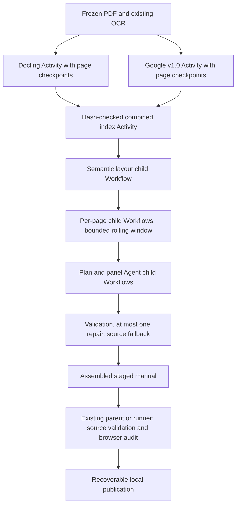

# Development and deployment

## Install and test

Run from the repository root with Python 3.12+ and Node.js 22+:

```bash
uv sync --locked --all-groups
npm ci
uv run python -m pytest tests -q
npm test
npm run lint
```

Python tests use fake providers and temporary files; the ordinary suite does not
spend API credit. Frontend tests use Node's built-in test runner. `npm run lint`
checks public JSON, frontend files, Markdown and workflow formatting; `npm run
format` applies the same formatting. Formatting manual JSON must not change its
parsed contents.

The separate Temporal integration test starts an isolated local server, uses the
real Agents plugin with fake external services, tests retry and the full PDF
pipeline, replays histories generated by the current code, and measures the
real viewer in Chrome. It also checks browser-unavailable and incomplete-OCR paths:

```bash
RUN_TEMPORAL_INTEGRATION=1 uv run python -m pytest tests/test_temporal_agents_integration.py -q
```

It needs the Temporal CLI and Google Chrome installed locally.
The CI unit run skips this opt-in test. Live Google/OpenAI smoke tests are separate
and billable; they are not needed for documentation or frontend changes.

Ruff and mypy are installed in the dev group. Whole-repository strict checks
still report legacy lint/type debt; do not describe them as passing. Check a
changed Python module and its tests, using `--follow-imports=silent` when isolating
it from existing dependency-module type errors:

```bash
uv run ruff check src/workflows/agent_workflows.py tests/test_temporal_agents.py
uv run ruff format --check src/workflows/agent_workflows.py tests/test_temporal_agents.py
uv run mypy --strict --follow-imports=silent src/workflows/agent_workflows.py tests/test_temporal_agents.py
```

## Code map

| Location                 | Responsibility                                                       |
| ------------------------ | -------------------------------------------------------------------- |
| `src/cli.py`             | PDF/URL input, managed workers, progress, index maintenance          |
| `src/worker.py`          | Workflow and Activity registration on `manual-translation`           |
| `src/temporal_client.py` | Shared Client and official Agents-plugin configuration               |
| `src/workflows/`         | Parent pipeline, phase children and durable agent orchestration      |
| `src/activities/`        | Google APIs, rendering, browser auditing, publication and agent I/O  |
| `src/cleanup.py`         | Structured cleanup schema and source-preserving application          |
| `src/quality/`           | Shared browser metrics, experiments, glossary evidence and reporting |
| `src/tagging.py`         | Shared catalog tag definitions                                       |
| `web/`                   | Static catalog, reader, editor and direct PDF export                 |
| `tests/`                 | Python tests and `tests/web/` frontend tests                         |

## Worker behavior and recovery

The local server defaults to `localhost:7233`; its UI is normally at
`http://localhost:8233`. The CLI always launches its requested worker processes,
even if another persistent worker exists. For an additional long-lived worker:

```bash
uv run python -m src.worker
```

Workers on the same task queue can execute any queued work for that queue.
Do not start a shared-queue worker expecting it to consume only one chosen run.
Restart persistent workers after code or dependency changes. Keep the Temporal
server's state and local run artifacts when recovering an in-flight workflow;
restarting the translation CLI instead starts another workflow.

The parent stages output, runs OCR, translation, site generation, cleanup and semantic-layout child
workflows, validates source coverage, audits each page and publishes last.
OCR schedules page Activities with fan-out/fan-in, bounded by worker capacity.
Browser audit Activities also fan out per page and heartbeat while Chrome runs.
They share the local worker pool; no separate worker service is needed.
One manual's AI cleanup batches run sequentially. More workers help when ready
Activities are waiting; they cannot reduce a running model request's latency.
Production workers register one concurrent Activity each by default.

Model calls use a five-minute attempt timeout, a fifteen-minute schedule-to-close
limit and at most three attempts. The OpenAI client's own retry loop is disabled
so Temporal owns retries. File preparation/application are separate Activities;
credentials stay outside Workflow payloads. Larger image payloads may produce
Temporal warnings; each image request is capped and loaded inside its child run.

A missing product URL does not pause new workflows. Optional glossary/cleanup
failures retain the machine draft and produce advisory warnings. An OCR page
failure fails the parent before translation/publication; missing images, empty
translations, changed Japanese/boxes or incomplete page coverage also prevent
publication. Successful illustration-only pages may contain no text.

New workers and the CLI use `manual-translation`, isolating the simplified
schedule from the old `pdf-translation` queue. Old histories are intentionally
unsupported; no server data is deleted. Restart persistent workers to load this
code. Current-run retries and replay still work through Temporal and the official
Agents plugin.

## Staging, audit and publication

Each run owns `benchmark-runs/publication/<run-hash>/`. Its `staging/` folder is
absent from the catalog. `source.json` preserves the pre-cleanup source. The audit
freezes public viewer assets and the manual, then records desktop 1280×900, phone
390×844 and canonical desktop PDF metrics/screenshots per page. Browser measurements are
deterministic checks, with no extra AI-coordinate edit or model call. The Chrome
version and renderer/manual/image hashes identify what was measured.

`quality_status` is `complete`, `complete_with_warnings` or `failed`. Overflow,
small text, optional AI failures and unavailable/incomplete browser measurements
are warnings and never require human approval. The CLI prints their summary and
the local audit path. Layout warnings are heuristics, not semantic error counts
or proof of semantic accuracy.

Publication checks that the staged data and renderer still match the audit and
that published JSON has not changed since the run began. A local file lock
serializes replacements and atomic catalog writes. The old folder moves to
`previous-manual/` before replacement; result markers allow a retried publication
to finish without replacing it again. Source-validation and conflict failures retain the existing manual; failed
stages remain available for diagnosis. A completed swap can recover its result
and catalog on retry. Keep these local artifacts
while a run can retry; backups and audit captures consume disk space. This is a
single-machine design, not a distributed storage protocol.

## Repair existing translations

Audit the corpus without rerunning OCR or initial translation:

```bash
uv run python -m src.quality.corpus_repair --run-id corpus-audit-2026-11-04
```

Add `--apply` to run targeted repairs and publish them after the audit. By default,
AI cleanup only sees regions with missing accepted terms or numeric/literal-label
concerns. `--legacy-list path/to/list.json` accepts a JSON array of manual directory
names that also need the full current page-aware cleanup. Choose those explicitly;
it is not a request to regenerate every manual. Start the local Temporal server
first; the command manages its own worker on an isolated queue, with up to eight
manuals, six model requests and three browser pages in flight. Graceful worker shutdown allows up to
five minutes for active calls to finish. Paid calls use the
same official Temporal Agents integration as new translations.

The run freezes the shared glossary and original JSON, audits desktop/phone/PDF,
normalizes reversed rectangle endpoints, restores literal labels and applies
formatting rules. Numeric findings normalize common English number words and Japanese battery-size
codes. Other number wording, diagram references and OCR fragments can still
produce heuristic concerns. The final guard rejects new numeric loss or
invented numeric tokens, invalid literal labels and lost accepted names. It
preserves existing metadata and source regions; only exact page/block counts are
refreshed. Pending glossary terms stay advisory. Repairs do not reconstruct
source blocks that older runs already removed.

Saved batch replies are reused after interruptions; recovery schedules only missing
model batches. A failed manual stays in staging while independent manuals finish.

Run state, before/after metrics, screenshots, proposed/rejected changes and
original JSON remain under `benchmark-runs/`. Reuse the same run ID and legacy
list to resume without scheduling completed model calls again. Replacements use
the normal publication backup/conflict checks. Browser warnings and remaining
terminology/numeric concerns do not add a human approval step or preview page.

## Semantic grouping and corpus migration

Japanese-to-English runs now finish with `SemanticLayoutWorkflow` after draft
cleanup and before browser audit/publication. `SemanticPageWorkflow` freezes
source scans and OCR, asks a structured page planner for source-ID membership,
then translates complete prose panels from independent crops. Default planning
is `gpt-5.5` (`LAYOUT_MODEL`); panel translation uses `OPENAI_MODEL`, default
`gpt-5-mini`. Existing valid single-heading translations are reused. The official
Temporal Agents plugin owns all model calls. Page and panel fan-out is bounded.

The existing panel translation call also handles English style: direct verbs,
natural sentence structure and concise wording. Courtesy filler is omitted only
when it adds no practical meaning. Safety facts, actions, conditions, negations,
quantities, codes, consequences and useful qualifications remain required, as do
accepted glossary terms. The same instructions apply to the bounded repair;
there is no additional style-only model pass or regex deletion of repeated words.
Deterministic request tests check these instructions and source preservation,
not the quality of unseen model output. Changed prompts require a new repair run
ID; exact-request caches still apply.

Furigana is omitted only from English display; source text, boxes and attached
parent IDs persist in the manual JSON. Candidates include small hiragana,
katakana and mixed-kana readings above kanji or acronyms such as DX. The planner
must confirm the reading relationship, including guides above headings and
diagram labels whose base text stays ungrouped. Confirmed guide-only OCR rows
are excluded from panel translation context; ordinary katakana labels stay.
Ambiguous kana stays retained. Geometry
comes from source regions and rich OCR lines, with checks against neighboring
regions and large connected illustration ink. Solid background color is allowed.
The planner cannot submit coordinates. Panels that include illustration ink are
split into smaller text units where possible. OCR continuations stop before
neighboring headings. After splitting, strong unfinished Japanese clauses can
reclaim up to three adjacent source regions in the same text column, including
regions split into another prose panel. Recovery must reach a complete clause
and pass the existing source-membership and illustration-mask checks; otherwise
the tentative join is rolled back. This fixes sentence endings lost during
illustration protection without widening masks over diagrams or merging columns.
The reconstructed panel's crop and cached rich OCR provide translation context.

Prose validation detects strong dangling Japanese/English endings and rejects
new Japanese clause endings unsupported by source/OCR when completing a fragment.
These conservative heuristics are not a grammar or semantic-accuracy proof.
Detected fragments use the existing single bounded repair with source-only
completion instructions; rejection evidence remains in run-local files.
Adjacent paired output items ending in a Japanese continuation can be joined
within the same independently cropped panel, at most three joins, without adding
or deleting words. All ordinary source/safety checks still run afterward. The
battery check also rejects contradictory “single-A” wording for explicit Japanese
AA/AAA designations; it is not an exhaustive battery terminology validator. If the
source cannot support a safe completion, the original grounded draft remains,
even if it is incomplete. No guessed action or human gate is introduced.
Invalid proposals retain the existing
overlay; failed translation checks allow one targeted repair and then retain the
old translation. This fallback is advisory, with no mandatory review page.
Readable source artwork keeps its scan pixels without a redundant English box.
A small deterministic set covers polarity symbols, arrows, check/cross graphics,
LED and ON/OFF labels. The existing image planner confirms eligible readable
English/branding and standalone diagram step numerals; uppercase text alone is
not sufficient. Japanese/mixed-language instructions, battery specifications and
counts, and ambiguous glyphs retain overlays. Native-artwork IDs cannot enter
prose panels or be reclaimed by clause recovery; overlapping paragraph masks are
rejected or clipped. The existing negative-display-index ledger disposition
records each omission, alongside exact source text/geometry. Editor export and
explicit regrouping preserve the source records and repeat the classification.
These bounded rules do not certify OCR or model judgments.
Source-ledger completeness is checked again before publication.

Explicit regrouping carries the preceding page as private planning context.
If a replacement only splits an accepted unit into fragments, final assembly
keeps the complete prior unit; contents rows remain separate. The context is
not copied into the published ledger. Dangling unclaimed clauses can seed the
existing bounded continuation recovery, with column, artwork and printed-rule
checks. Independent OCR can corroborate a circled-digit polarity error only in
the matching upper/lower-side battery clause; other quantities stay protected.
Numbered instructions use source-backed circled numerals, with bullets reserved
for unnumbered items.

Pages opt in through `layout_provenance.readability.version: 1` or validated
`layout_provenance.structure.version: 1` from the combined pipeline. The latter
activates the same fitter for regenerated manuals outside the original pilot.
The shared browser/PDF fitter uses
page-relative role scales, expands only through verified scan whitespace without
crossing source regions or printed borders, and fits intact words inside the
resulting boxes. Font consistency is a preference, not an absolute pixel floor.
Overlapping text areas are partitioned; original masks and source coordinates
remain distinct from the transient English layout. Constrained fits remain
measurable. Text never moves into appended notes or a footer; the existing side
panel already provides an alternative reading format. Pages without either
versioned record retain the existing fitter.

English overlays are checked for non-Latin letters across scripts, allowing
electrical units µ, μ and Ω. Unclaimed untranslated labels enter the existing
cropped translation stage; a failed bounded repair retains source-grounded text
and reports an advisory warning. This detects script leakage, not English fluency
or name accuracy. Source-backed Japanese battery codes become AA/AAA without
changing counts. Duplicate source quotations can use their already-present
English equivalent only when the source confirms the quoted fragment.
Short other-script OCR fragments and lone Japanese glyphs are scan-confirmation
candidates for diagram marks; they are never automatically deleted. Meaningful
labels remain translated, and original source text and boxes stay in the ledger.

Repair the existing corpus through the same stage:

```bash
uv run python -m src.quality.semantic_repair --run-id semantic-repair-2026-11-04
# Limit an initial run to one manual:
uv run python -m src.quality.semantic_repair --run-id semantic-one --manual "Manual folder"
```

The command manages its own isolated queue/worker, three manuals, six Activities
(including model calls), and three browser slots. It freezes the glossary and
source JSON, reuses exact-match rich OCR where available, and caches fresh OCR for
older pages. Completed model replies are saved before validation. Reuse the same
run ID to resume; published manuals are skipped and failures stay in staging.
Choose a new run ID after changing code, prompts, models or source inputs. A
manual already marked `meta.semantic_layout: 1` is skipped to protect subsequent
editor changes. Use `--regroup` with a new run ID to explicitly retranslate
previously grouped prose; this can replace final prose edits. Current standalone
label edits are retained as the next draft. Exact-request reply and identical-scan
OCR caches are reused across runs; changed inputs are checked again. No initial full retranslation of unchanged diagram labels is
required. Final desktop/phone/PDF measurements precede replacement, with existing
backup and concurrent-edit protections.

Grouped paragraph masks improve desktop reading but do not solve all phone
overflow. Fewer display regions or flags do not prove translation accuracy.

## Dependencies and credentials

`uv.lock` and `package-lock.json` define the tested environment. Avoid claiming
that a dated dependency snapshot is permanently the latest release. For an
intentional upgrade:

```bash
uv sync --all-groups --upgrade
npm update
uv tree --outdated
npm outdated
```

Run the suites and isolated Temporal integration afterward. The supported
`openai-agents` range is constrained by the Temporal integration; do not bypass
it just to install a newer version. Restart persistent workers after upgrading.
YomiToku and its heavy dependencies belong in the separate optional environment
described in the [benchmark guide](../benchmarks/README.md#optional-local-models).

Keep `.env`, service-account keys, source PDFs and `benchmark-runs/` out of Git.
The optional `OPENAI_MODEL` and `GLOSSARY_MODEL` overrides are documented in
[.env.example](../.env.example). `INSTRUCTION_CHECK_MODEL` and the local crop-OCR
settings support offline experiments, not the current pipeline.

## GitHub checks and Pages

Pull requests run Python unit tests, frontend tests and formatting checks.
Checks report failures without pushing automatic formatting commits.
Use `npm run format` locally before pushing when formatting is the only failure.

Pushing `main` or dispatching the Pages workflow builds the public website. It
installs the locked production environment and calls the same `src.cli reindex`
used locally, then stages only `web/` contents and `manuals/` under `_site`.
No Google/OpenAI credentials or API requests are needed to build the site.
The root URL serves the catalog; the site requires no backend translation worker.

Enable GitHub Pages with GitHub Actions as the source and configure the repository's
Pages environment and custom domain in GitHub's repository settings. Optional
`CLOUDFLARE_ZONE_ID` and `CLOUDFLARE_API_TOKEN` repository secrets enable cache
purging; the public site does not need them to build. For a fork, update
the Pages custom domain, the cache-purge URLs in `.github/workflows/static.yml`
and `GITHUB_CONFIG.REPO` in `web/js/config.js`.

Before pushing, include new manual JSON, all referenced page images, the shared
glossary, lockfiles, frontend modules/fonts and tests. The catalog alone is not
a deployable manual. Verify that no credential or research-cache file is included.
The existing manual removal remains a real deletion in the proposed changes;
do not regenerate it just to satisfy inventory counts.

## Known verification limits

- PDF output rasterizes text for browser-layout fidelity; it is not searchable.
  Actual Chrome downloads are compared with native desktop captures. Safari,
  Firefox and real mobile-device memory limits remain unverified. See the
  [PDF guide](viewer.md#pdf-download).
- Native Windows execution and WSL/RTX 3090 inference have not been validated.
- AI assessment and structural checks do not establish translation accuracy or
  zero errors. Preserve source scans and evaluate changes before replacing edited
  manuals in bulk.

## Browser text-fitting regression

An opt-in Chrome test exercises real fonts and fractional OCR-sized boxes; it
requires Google Chrome installed locally and makes no model calls:

```bash
RUN_LAYOUT_BROWSER_TESTS=1 uv run python -m pytest tests/test_layout_browser.py -q
```

Text fitting measures fractional text bounds and line height rather than integer
scroll dimensions, and reserves the reader overlay's border space. Reader and
PDF capture use the same probe helper. Module assets use version `v=18` so existing
browsers load the correction. The [rendered-layout trial](../benchmarks/README.md#rendered-layout-trial)
records the historical Geartlinger measurements.

## Browser PDF export validation

The static deployment includes checked-in browser bundles and upstream licenses
under `web/vendor/`. Reproduce them after `npm ci` with `npm run vendor:pdf`.
Versions are locked. Capture restores measured rectangles and fitted font sizes
after CSS serialization, avoiding upstream font rounding and fractional-width
loss. No runtime CDN or backend is required. Keep the generated files with dependency upgrades.

Run the actual download and pixel comparisons using public-only temporary servers:

```bash
RUN_PDF_BROWSER_TESTS=1 uv run python -m pytest tests/test_pdf_export.py -q
```

Set `PDF_EVIDENCE_DIR` to retain PDFs, native screenshots and per-page comparison
measurements. The audit's `pdf` view measures the actual desktop capture frame;
it replaces the removed A4/print renderer. Old audit artifacts retain their old
view names and hashes; remeasure touched manuals rather than relabeling history.

## Layout-engine comparison

`LayoutBenchmarkWorkflow` validates a frozen PDF manifest, then runs Docling,
PyMuPDF and Google Layout Parser as independent Activities.
Provider failures are isolated and saved page results are reusable. The original
PDF, single-page inputs, raw outputs and normalized top-left geometry stay
separate from public manual JSON. Table cells retain row/column spans; Docling's
document tree supplies reading order. PyMuPDF native extraction and its
Tesseract-assisted scan path are labeled separately.

The optional Docling dependency runs in an isolated environment through
`scripts/docling-layout.py`; production dependencies do not change. Model files,
Japanese/English Tesseract data **and Tesseract config files** must be present.
A missing `configs/tsv` causes plain-text output and an upstream `KeyError: text`.
Frozen manifests can specify `docling_psm: 11` for a sparse-text diagnostic arm.
Use a distinct output directory for each engine/configuration comparison.
The inspection Activity fingerprints the manifest and Docling executable path,
and rejects a changed configuration in an existing output directory. This guards
against reusing page checkpoints after changing the page selection or OCR settings.

```bash
uv run --no-sync python -m src.quality.layout_compare \
  --manifest benchmark-runs/layout-engine-comparison-2026-11-05/manifest.json \
  --output benchmark-runs/layout-engine-comparison-2026-11-05/results-new \
  --docling-python benchmark-runs/layout-engine-comparison-2026-11-05/.venv/bin/python \
  --provider docling --provider pymupdf --address localhost:7235
```

Google requires an explicit Layout Parser resource; omitting it records a deferred
result and never substitutes the existing OCR processor. For Google-only runs,
add `--provider google --google-processor projects/PROJECT/locations/us/processors/ID`
and an explicit `--google-version`. The default version is
`pretrained-layout-parser-v1.0-2024-06-03`, with bounding boxes requested. Processor,
version and source-page identity are checked before reusing raw responses.
The CLI returns a failing exit status when a provider reports failure.

Normalization retains nested reading order, list contents, merged-cell spans and
coordinate-free blocks. Cell boxes are unions of supplied child-text extents,
not guaranteed printed borders. Version 1.5 returned no boxes on the four Double
Driver diagnostic pages; missing coordinates remain absent. Processing uses a
worker thread, while the async Activity emits heartbeats on its event loop.
Processor-management permissions are not required for processing: the pilot
account could process documents despite being unable to read processor metadata.

The benchmark performs extraction/layout analysis, not translation or publication.
Its cached-Google-OCR text overlap is a diagnostic agreement score, not independently
established OCR accuracy; comparisons within one provider can be correlated.

## Docling-guided semantic layout

The optional `SemanticLayoutInput.layout_index` connects frozen Docling outputs
to the existing OCR/planning/translation pipeline. A separate
`prepare_structure_activity` checks the source PDF hash, artifact hashes and page
identities, then matches original OCR regions to normalized layout geometry.
The planner receives region labels, source-ID matches, reading order, cells and
picture bounds, without Docling's recognized text. Original Japanese and source
boxes remain unchanged.

An index has `source_sha256` and a `pages` array in source-page order. Each page
contains zero or more `{ "path": "…", "sha256": "…" }` records referring to
normalized `LayoutPage` JSON files. Paths resolve relative to the index; absolute
paths are also supported. Multiple configurations remain separate hypotheses.
Use a new run ID when changing evidence or settings:

```bash
uv run python -m src.quality.semantic_repair \
  --run-id docling-guided-example --manual "CSM Double Driver v2" --regroup \
  --layout-index /absolute/path/layout-index.json
```

The CLI accepts an index for exactly one selected manual. The normal application
client uses its configured local Temporal address; a custom runner can connect to
another server with the same registered Workflows and Activities.

Matching requires at least 80% coverage of an OCR source rectangle. Ambiguous
matches and disagreements stay advisory; an unmatched source never disappears.
Clear independent list/cell/heading and bounded picture-membership boundaries split proposed panels after clause
recovery, and previous-panel preservation respects the same checks. Source-backed
subordinate clauses can continue across list-item hypotheses; printed cells remain
independent. A shared container alone never forces a merge.

The saved `layout_provenance.structure` retains the evidence and its disagreements.
The browser/PDF whitespace fitter also rejects expansion that adds overlap with
detected pictures or leaves an enclosing detected cell. Existing scan-pixel and
source-region protections still apply. A picture hypothesis covering at least 65%
of the page stays advisory, since a scanned table can be classified as a whole-page
picture. Whitespace checks count newly covered ink outside the intersection with
the original rounding allowance; ink outside a candidate cannot authorize its
expansion. Ruled-cell projection uses an immutable, hashed copy of the original
scan in the page's run directory when available,
rather than a resized planning image. A single complete entry can occupy its
enclosing printed cell only with strong text agreement, meaningful extra width,
no competing translated region and no detected diagram overlap. This remains
advisory structural evidence; imperfect detections are not proof of semantic correctness.
Browser audits verify every rendered parent/projection pair, so distinct cells
sharing an editor parent cannot hide a missing or duplicated measurement.

## Combined Google v1.0 + Docling pilot workflow

`CombinedLayoutWorkflow` composes the existing parser and semantic components.
Its input contains a staged `SemanticLayoutInput`, frozen parser jobs and an
explicit parser task queue. A parser worker registers input inspection, Docling
and Google Activities; the model worker registers `WORKFLOWS` / `ACTIVITIES`.
The pilot runs at most two parser jobs and eight model-worker Activities, with
three concurrent semantic pages and three concurrent panel translations per page.



A required parser failure prevents fusion; it is not silently treated as a
successful combined run. Every declared normalized page must exist, have the
correct provider/page identity and match a source-verified manifest. Both Google
and Docling must cover the complete manual; an additional sparse Docling variant
may cover a subset. Parser Activities retain raw per-page checkpoints, so retries
reuse completed pages. Docling stays batched to amortize isolated-model setup.
The pilot imports already-verified raw results into run-owned caches, preserving
the earlier benchmark artifacts.

Google cell boxes are marked `text_extent` and become `cell_text` evidence. They
can separate semantic entries but never constrain the renderer's maximum English
box. Printed borders, neighboring source regions and scan pixels still determine
usable space. Structurally split panels pass the existing geometry guard again;
unsafe overlapping OCR proposals fall back to original overlays within the page.
Omission recovery runs before structural splitting. Geometry fallback after that
split cannot recover dropped neighboring source IDs; they retain original overlays.
This prevents a conservative geometry fallback from undoing confirmed row boundaries.

Rolling windows replace cohort barriers for new semantic Workflows. Patch IDs
`semantic-page-window-v1` and `semantic-panel-window-v1` retain the old execution
path when replaying histories without those markers. One slow page or panel no
longer holds every later job in its cohort; global worker capacity still bounds
model calls. Existing pre- and post-patch histories must replay before rollout.

Orchestration stages pass file references. The official Agents integration still
materializes vision prompts in individual Agent child histories, so not every
payload is externalized. Measure their size; do not describe these as reference-only
histories. The local artifact store assumes shared filesystem access and retained
run directories. Distributed/Cloud workers would need a shared artifact store and
an appropriate large-payload strategy before deployment.

The completed local CSM Double Driver pilot is recorded in
`benchmark-runs/google-docling-pilot-v2-2026-11-06/`: all 30 pages preserve existing
OCR and original source regions, and all 64 imported parser responses retain their
hashes. The successful parent and priority-page histories replay, as do five older
histories. Browser/PDF audits and the actual downloaded PDF pass export checks;
some combined table labels and dense dialogue cells remain for review. No other
manual was regenerated. The peak saved model request is 1,204,245 bytes, so the
Agent-history payload limitation above is measured rather than hypothetical.

## Combined corpus regeneration

The existing semantic corpus runner also composes the combined pipeline. Use
`--regroup`, `--google-processor`, `--docling-python`, `--docling-assets` and an
explicit `--address` to enable it. It retains the same source validation, cached
model calls, browser audit and recoverable publication path as semantic-only runs.
A separate parser worker allows two concurrent conversions; each model worker has
eight Activity slots, with configurable manual concurrency and three browser
audits at most. The current corpus run uses six concurrent manuals and three model
worker processes (24 Activity slots). Additional
workers poll the same model queue in separate processes; overlapping Workers on
one queue in the same client process are rejected by the SDK.

```bash
uv run python -m src.quality.semantic_repair \
  --run-id combined-corpus-2026-11-06 --regroup --address localhost:7235 --manual-concurrency 6 \
  --google-processor projects/macro-nuance-466220-c0/locations/us/processors/5616b5a90d1e63fe \
  --docling-python benchmark-runs/layout-engine-comparison-2026-11-05/.venv/bin/python \
  --docling-assets benchmark-runs/layout-engine-comparison-2026-11-05
```

Select outstanding manuals with repeated `--manual` flags; the completed Double
Driver pilot need not run again. Configuration is frozen under the run ID, and
published manuals are skipped on recovery. Original PDFs are checked against the
published page count and canvas aspect, with immutable per-page PDFs and hashes.
If publication completed before runner status was saved, recovery verifies its
durable receipt, JSON/scan hashes, source ledger and complete audit before recording
it as published; a changed current manual is rejected rather than overwritten.
When an original PDF is absent, a layout-only PDF embeds each existing scan at its
own canvas dimensions without rescaling its pixels. All existing OCR lines and
source regions must survive regeneration. Audit coverage must include every page
before publication; text fitting warnings remain visible as advisory findings.

For regrouping, the existing source-linked OCR ledger takes precedence over
render-image caches, so a different PDF canvas does not trigger different
recognition. Reuse requires matching image identity and original text/geometry;
an incompatible existing checkpoint requires a fresh run namespace. Prior
scan-confirmed native artwork is retained on that same source. Accepted English
can repair a fallback with identical source membership, and explicit quotation
equivalents can be retained from unambiguous aligned prior items. Conflicting or
unmatched equivalents are not guessed. These rules preserve prior review decisions
without per-manual names, page coordinates or a relaxed English-script validator.

The rejected Custom Extractor experiment and its tests/runner were removed after
evaluation. Its findings remain in `blog.md`; no Custom Extractor code is used by
the combined pipeline. Prior Workflow patch branches remain necessary for replay.
